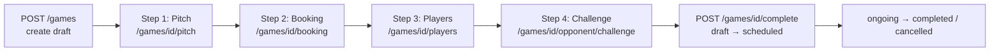

# ⚽ Game Creation Flow — Documentation

This document explains the complete **Game Creation** process implemented in this project: the 4-step wizard, the database structure, the API endpoints, the business rules, and the authorization model.

---

## 📖 Table of Contents

1. [Overview](#1-overview)
2. [Architecture & Files](#2-architecture--files)
3. [Database Structure](#3-database-structure)
4. [The 4-Step Wizard](#4-the-4-step-wizard)
5. [Game Lifecycle (Status Transitions)](#5-game-lifecycle-status-transitions)
6. [Business Rules](#6-business-rules)
7. [Authorization & Security](#7-authorization--security)
8. [API Reference](#8-api-reference)
9. [cURL Cookbook — All Game Endpoints](#9-curl-cookbook--all-game-endpoints)
10. [Testing](#10-testing)
11. [Assumptions](#11-assumptions)

---

## 1. Overview

The Game Creation flow allows an authenticated user to organize a match through a **4-step wizard**:

| Step | Name | What happens |
|------|------|--------------|
| 1 | **Pitch** | Choose a saved pitch, create a manual pitch, or skip |
| 2 | **Game Settings** | Date, time, duration, game type (5v5…11v11), gender, privacy + attach a booking |
| 3 | **Team** | Register players on the home side (capacity is enforced by game type) |
| 4 | **Opponent** | Get recommended opponent teams and send a challenge |

The game starts as a **`draft`**. Each wizard step is an independent, optional API call on the draft — the frontend can implement the wizard UI freely (skip steps, go back, resume later). When everything is ready, the owner **finalizes** the game and it becomes **`scheduled`**.



---

## 2. Architecture & Files

The implementation follows the existing project conventions: **Controller → FormRequest → Service → Model**, with an envelope response `{status, message, results}`.

```
app/
├── Http/
│   ├── Controllers/Api/Game/GameController.php   # Wizard endpoints (thin controller)
│   ├── Requests/Game/                            # Validation layer
│   │   ├── StoreGameRequest.php                  # POST /games
│   │   ├── UpdateGameRequest.php                 # PUT /games/{game}
│   │   ├── StoreGamePitchRequest.php             # POST /games/pitches
│   │   ├── AttachBookingRequest.php              # POST /games/{game}/booking
│   │   ├── AttachPlayersRequest.php              # POST /games/{game}/players
│   │   └── ChallengeRequest.php                  # POST /games/{game}/opponent/challenge
│   └── Resources/Game/GameResource.php           # API response transformer
├── Models/
│   ├── Game.php                                  # Game model + scopes + helpers
│   ├── GameChallenge.php                         # Team-vs-team challenge
│   └── GamePlayer.php                            # Pivot: game ↔ player_stats
└── Services/
    └── GameService.php                           # ALL business logic (transactional)

database/
├── migrations/2026_09_26_163147_create_games_table.php
└── migrations/2026_09_26_170000_create_game_challenges_table.php  (+ game_player pivot)

routes/
├── Api/Game.php                                  # games.* routes (registered in routes/api.php)
└── api.php

tests/Feature/GameCreationTest.php                # 50 tests / 238 assertions
```

**Design principle:** the controller only handles HTTP (auth checks, status codes); every business rule (capacity, conflicts, ownership, transitions) lives in `GameService` and runs inside a **DB transaction**, so a failed step never leaves partial data.

---

## 3. Database Structure

### `games` table

| Column | Type | Notes |
|--------|------|-------|
| `id` | bigint PK | |
| `user_id` | FK → users | **Owner — always `auth()->id()`, never from request** |
| `game_pitch_id` | FK → game_pitches, nullable | Manual pitch (Step 1) |
| `booking_id` | FK → **bookings**, nullable | Uses the existing booking system (**not** `field_bookings`) |
| `game_date` | date | |
| `start_time` | time | |
| `duration` | int (minutes) | 1–300 |
| `game_type` | enum | `5v5, 6v6, 7v7, 8v8, 9v9, 11v11` (default `5v5`) |
| `gender` | enum | `male, female, mixed` (default `mixed`) |
| `privacy` | enum | `public, private` (default `public`) |
| `status` | enum | `draft, scheduled, ongoing, completed, cancelled` (default `draft`) |

Indexes: `(game_date, start_time)` for availability queries, `status` for filtering.

> **Game Teams redesign (v2):** `games.home_team_id` / `games.away_team_id` were **removed**.
> Each side now lives in its own `game_teams` row — see below.

### `game_teams` table (new — the core of the redesign)

| Column | Type | Notes |
|--------|------|-------|
| `game_id` | FK → games, cascade | |
| `team_id` | FK → teams, **nullable** | Set **only** for `permanent` game teams; `null` for temporary |
| `owner_id` | FK → users, cascade | For permanent: the team owner. For temporary: the user who picked the players |
| `name` | string | Permanent → real team name; temporary → e.g. `home_team_name` or `"John's Team"` |
| `type` | enum | `permanent` / `temporary` (default `temporary`) |
| `side` | enum | `home` / `away` |
| | | **unique(`game_id`, `side`)** — one game team per side |

> ⚠️ A **temporary** game team is NEVER written to the `teams` table. It exists
> only as a `game_teams` row and is deleted with its game.

### `game_players` table (new — replaces the `game_player` pivot)

| Column | Type | Notes |
|--------|------|-------|
| `game_id` | FK → games, cascade | |
| `game_team_id` | FK → game_teams, cascade | Which side the player belongs to |
| `player_stat_id` | FK → player_stats, cascade | Players are identified by `player_stats.id` |
| `status` | enum | `pending` → `joined` (accepted) / `declined` (rejected); `left` on removal |
| | | **unique(`game_team_id`, `player_stat_id`)** |

> Players picked individually start **`pending`** — they are confirmed members
> only after accepting their `game_player_requests` entry.

### `game_player_requests` table (new — the invite layer)

| Column | Type | Notes |
|--------|------|-------|
| `game_id` | FK → games, cascade | |
| `game_team_id` | FK → game_teams, cascade | |
| `player_stat_id` | FK → player_stats, cascade | The invited player |
| `initiated_by` | FK → users, cascade | Who sent the request |
| `status` | enum | `pending, accepted, rejected, cancelled` (default `pending`) |
| `message` | text, nullable | Optional invite note |
| `responded_at` | timestamp, nullable | Set when the player answers |

> Why a new table instead of `team_invitations`? `team_invitations.team_id`
> has a **hard FK to `teams`** and cannot reference a temporary game team.

### `game_challenges` table (re-shaped)

| Column | Type | Notes |
|--------|------|-------|
| `game_id` | FK → games | |
| `challenging_game_team_id` | FK → game_teams | The **home game team** sending the invite (permanent or temporary) |
| `challenged_game_team_id` | FK → game_teams, nullable | The opponent side once it exists |
| `challenged_team_id` | FK → teams, nullable | Option A — challenge a permanent team |
| `challenged_user_id` | FK → users, nullable | Option B — challenge a user; also auto-set for Option A (team owner) |
| `initiated_by` | FK → users | `auth()->id()` at challenge time |
| `status` | enum | `pending, accepted, rejected, cancelled` (default `pending`) |
| `message` | text, nullable | Optional note to the opponent |
| `responded_at` | timestamp, nullable | Set when the opponent answers |

---

## 4. The 4-Step Wizard

### Step 0 — Create the draft

`POST /api/games` creates the game in `draft` status. All step endpoints then operate on this draft. Steps are **independent and skippable** — e.g. a pickup game needs no pitch, no booking, and no away team.

### Step 1 — Pitch

Three options:

| Option | Endpoint | Behavior |
|--------|----------|----------|
| Pick a saved pitch | `POST /games/{id}/pitch` with `game_pitch_id` | Validates the pitch belongs to the user |
| Create a manual pitch | `POST /games/pitches` (name, address, lat/lng) | `user_id` comes from auth; then attach it |
| Skip | `POST /games/{id}/pitch` with `game_pitch_id: null` | Pitch stays empty |

If a **booking** is attached instead, its `field` acts as the location.

### Step 2 — Game Settings & Booking

Core settings (`game_date`, `start_time`, `duration`, `game_type`, `gender`, `privacy`) are set at draft creation and editable while the game is a draft (`PUT /games/{id}`).

Booking attachment (`POST /games/{id}/booking`) supports two modes:

1. **Existing booking**: pass `booking_id` — must belong to the authenticated user, else `422`.
2. **Create new**: pass `field_id`, `booking_date`, `start_time`, `end_time`, `total_price` — a `Booking` is created (`status: pending`, `payment_status: unpaid`, auto reference `BK…`) and linked to the game inside one transaction. Double-booking is rejected (see [Business Rules](#6-business-rules)).

### Step 3 — Team / Players (the Game Teams decision)

At creation (and while a draft), the user **must** explicitly choose how their
**home side** is built — the system never assumes one for them:

| Choice | Payload | What the system does |
|--------|---------|----------------------|
| **Option A — "Play with my team"** | `home_team_id` (plus optional `booking_id` etc.) | Creates a **`permanent`** game team; the roster is copied from active `team_members` with `status: joined`. Ownership is verified (`team.user_id == auth()->id()`), and the team must have at least one active member |
| **Option B — "I don't want to play with my team / I want to choose players"** | `home_players: [player_stat_id, …]` + optional `home_team_name`, `message` | Creates a **`temporary`** game team (`teams` table is NEVER touched), adds each player as `pending`, and sends one `game_player_requests` invite per player |

**The SAME create request may also build the AWAY side** (self-organized match,
one POST = both sides):

| Away payload | Result |
|--------------|--------|
| `away_players: [player_stat_id, …]` + optional `away_team_name` | second **`temporary`** game team + pending invites (same rules as home) |
| `away_team_id` | second **`permanent`** game team, roster copied from that team's active members (team must belong to the caller) |
| *(omitted)* | away is not created — built later via `POST /games/{id}/players` (`side: away`) or a challenge |

**The SAME create request may also send the CHALLENGE (Step 4 in one POST):**

| Challenge payload | Result |
|-------------------|--------|
| `challenge_team_id: X` | challenge permanent team X (its owner is auto-recorded as `challenged_user_id`) |
| `challenge_user_id: Y` | challenge user Y (plays with a hand-picked side) |
| optional `message` | free-text invite note stored on the challenge |

Challenge-in-create rules:

- The two targets are **mutually exclusive** → `422: "Challenge either a team or a user, not both."`
- Cannot be combined with the away fields → `422: "Remove the away side fields — the challenge lets the opponent build the away side."`
- The home side must exist in the same request (`home_team_id` or `home_players`) → otherwise `422: "Choose the home side before sending a challenge."`
- Every `challenge()` rule applies unchanged (no self-challenge, team ownership, home-side-only) — and since it runs **inside the same transaction**, a failed challenge rolls back the whole draft (no orphan game rows).

Rules:

- The two options are **mutually exclusive** → `422: "Choose either a team or players, not both."` (same for `away_team_id` + `away_players` together)
- Choosing **neither** → `422: "Choose a team to play with or select players."`
- **Capacity**: `game_type` caps each game team — `5v5` → 5. Overfill → `422: "Too many players for 5v5: max 5 per side."`
- **Requests**: only the invited player (owner of the `player_stats` row) can respond via `POST /games/player-requests/{id}/respond` with `accepted` / `rejected`. `accepted` flips the `game_players` row to `joined` (confirmed member); `rejected` → `declined`.
- While the game is a draft, re-submitting replaces the side cleanly (previous pending requests are cancelled).
- `DELETE /games/{id}/players/{playerStatId}?side=home|away` removes a player from a side and cancels any pending invite.

**Building the AWAY side — two possible flows:**

1. **Self-organized match (option implemented here)** — the game owner picks the away players himself via `POST /games/{id}/players` with `"side": "away"`. The system creates the second **`temporary`** `game_teams` row (`team_id = NULL`) and sends the invites. This works **only while no accepted challenge has handed the away side to an opponent**.
2. **Challenge flow** — an opponent (User B) builds his own away side when accepting a challenge (with `team_id` or `player_stat_ids`). Once a challenge is accepted, the owner can no longer touch the away side (`422: "Only the challenged opponent can build the away side."`).

### Step 4 — Opponent / Challenge

1. `GET /games/{id}/recommended-opponents` — suggests teams matching the home team's **sport category** and **match type**, with same-city teams ranked first. The home team itself is excluded.
2. `POST /games/{id}/opponent/challenge` — the **home game team** (permanent *or* temporary) challenges **exactly one** target:
   - `{ "team_id": X }` → challenge a permanent team (its owner `user_id` is recorded as `challenged_user_id` so they can respond);
   - `{ "user_id": Y }` → challenge a user who plays with a hand-picked side;
   - sending both / neither → `422: "Provide either team_id or user_id."`
3. The recipient lists incoming challenges via `GET /games/challenges` (matched by `challenged_user_id` or `challenged_team_id ∈ my teams`) and responds:
   - `POST /games/challenges/{challengeId}/respond` with `status: accepted | rejected | cancelled`
   - **The opponent always decides how to build the AWAY side** — regardless of how the challenge was addressed:
     - accept with `team_id` (or a bare accept of a *team* challenge) → `permanent` away game team, roster copied;
     - accept with `player_stat_ids` (+ optional `name`) → `temporary` away game team with `pending` invites. Missing both on a user challenge → `422: "Choose either your team or the players you will play with."`

**Ownership rule — two AWAY flows:**

| Side | Controlled by | Built via |
|------|---------------|----------|
| HOME | User A (game owner) | `POST /games`, `PUT /games/{id}`, `POST /games/{id}/players` (`side: home`) |
| AWAY — **flow 0: same create request** | **User A (game owner)** | `POST /games` with `away_players` / `away_team_id` — builds home **and** away in ONE call |
| AWAY — **flow 0b: challenge in same create request** | User B (challenged) | `POST /games` with `challenge_team_id` / `challenge_user_id` — ONE call = draft + home + challenge; User B builds away on accept |
| AWAY — **flow 1: self-organized** | **User A (game owner)** | `POST /games/{id}/players` with `"side": "away"` (owner builds both temporary sides himself) |
| AWAY — **flow 2: challenge** | User B (challenged user / team owner) | challenge accept, then `POST /games/{id}/players` (`side: away`) |

- **Flow 0/1 (self-organized)**: while no challenge has been accepted, the owner may build home **and** away — the system creates two independent `temporary` `game_teams` rows for the same game, both `team_id = NULL`, both `owner_id = User A`.
- **Flow 2 (challenge)**: once a challenge is **accepted**, the away side belongs to the challenged user — the owner's away attempts now fail with `422: "Only the challenged opponent can build the away side."`, and User B cannot touch the home side (`PUT /games/{id}` → `404`).

Supported match-ups: **permanent vs permanent, permanent vs temporary, temporary vs permanent, temporary vs temporary** — both sides are just `game_teams` rows.

---

## 5. Game Lifecycle (Status Transitions)

```mermaid
stateDiagram-v2
    [*] --> draft: POST /games
    draft --> scheduled: POST /games/{id}/complete (finalize)
    scheduled --> ongoing: GameService::start()
    ongoing --> completed: POST /games/{id}/complete
    draft --> cancelled: POST /games/{id}/cancel
    scheduled --> cancelled: POST /games/{id}/cancel
    ongoing --> cancelled: POST /games/{id}/cancel
```

| Transition | Endpoint / method | Guard |
|------------|-------------------|-------|
| `draft → scheduled` | `POST /games/{id}/complete` | Owner only; only drafts can be finalized |
| `ongoing → completed` | `POST /games/{id}/complete` | Owner only |
| `* → cancelled` | `POST /games/{id}/cancel` | Owner only; allowed from draft/scheduled/ongoing |

Invalid transitions throw `InvalidArgumentException` → HTTP `422`. While the game is a **draft**, `PUT /games/{id}` is allowed; after scheduling, edits are rejected with *"Only draft games can be modified."*

---

## 6. Business Rules

All rules live in `GameService` and throw `InvalidArgumentException` (converted to `422` by the controller):

1. **Pitch ownership** — a manual pitch can only be attached to a game if it belongs to the authenticated user.
2. **Booking ownership** — attaching an existing `booking_id` requires `booking->user_id === auth()->id()`.
3. **No double-booking** — a user cannot have two overlapping games/booking on the same date. `Game::scopeOverlapping($userId, $date, $startTime, $duration)` performs the overlap check. It is written **driver-portably**: a SQL pre-filter (`start_time < end`) followed by an exact overlap comparison in PHP, so it works on both MySQL and SQLite (which lacks `TIME_TO_SEC`).
4. **Distinct teams** — `home_team_id` must differ from `away_team_id`.
5. **Side capacity** — players per side ≤ `playersPerSide()` (derived from `game_type`, e.g. `5v5` → 5).
6. **No both-side players** — one player, one side per game.
7. **Challenge sanity** — you cannot challenge your own team; you must own the game's home team to send a challenge; only `pending` challenges can be answered; only the **challenged team's owner** can respond.
8. **Transactional integrity** — draft creation, booking creation + attachment, player attachment, and challenge creation each run in `DB::transaction`. If any part fails, nothing is persisted (verified by a dedicated test).

---

## 7. Authorization & Security

- **`user_id` is never accepted from the frontend.** It always comes from `$request->user()->id` / `auth()->id()` server-side. There is no `user_id` field in any FormRequest's validated data.
- **Ownership checks** are manual in the controller (`$game->isOwnedBy($request->user()->id)`); non-owners receive `404` *"Game not found."* — this avoids leaking the existence of other users' games.
- **Private games** (`privacy: private`) are `404`-shielded from everyone except the owner, even on `GET /games/{id}`.
- All `games.*` routes are behind the `auth:sanctum` middleware.
- Route ordering: static segments (`/challenges`, `/pitches`) are registered **before** the parameterized `/{game}` routes so the word "challenges" is never bound as a game ID.

---

## 8. API Reference

All routes are prefixed with `/api`, require a Sanctum token, and respond with the envelope `{ "status": …, "message": …, "results": … }`. Validation failures return HTTP `422` with errors under `results.<field>`.

| Method | Endpoint | Name | Description |
|--------|----------|------|-------------|
| GET | `/games` | `games.index` | List own games (filter by `?status=`, paginated) |
| POST | `/games` | `games.store` | **Create draft** (wizard entry, `201`). Optional: `away_players` / `away_team_id` build the away side in the SAME request. Optional: `challenge_team_id` / `challenge_user_id` send the challenge in the SAME call |
| GET | `/games/{game}` | `games.show` | Game details (private = owner only) |
| PUT | `/games/{game}` | `games.update` | Update draft (owner, draft only) |
| DELETE | `/games/{game}` | `games.destroy` | Delete game (owner) |
| POST | `/games/pitches` | `games.pitches.store` | Create manual pitch (`201`) |
| POST | `/games/{game}/pitch` | `games.pitch.attach` | Step 1 — attach or skip pitch |
| POST | `/games/{game}/booking` | `games.booking.attach` | Step 2 — attach existing / create booking |
| POST | `/games/{game}/players` | `games.players.attach` | Step 3 — pick players for **one side**: `{"side":"home"\|"away", "player_stat_ids":[…]}` (owner → both sides pre-challenge; challenged opponent → away) |
| DELETE | `/games/{game}/players/{playerStat}?side=home\|away` | `games.players.detach` | Remove a player from a side (cancels invite) |
| GET | `/games/player-requests` | `games.player-requests.index` | **My received player requests** (filter `?status=pending`) |
| POST | `/games/player-requests/{request}/respond` | `games.player-requests.respond` | **Accept / reject** a player request |
| GET | `/games/{game}/recommended-opponents` | `games.opponents.recommended` | Step 4 — opponent suggestions |
| POST | `/games/{game}/opponent/challenge` | `games.opponent.challenge` | Step 4 — challenge a team **or** a user (`201`) |
| GET | `/games/challenges` | `games.challenges.index` | Challenges sent to me / my teams |
| POST | `/games/challenges/{challenge}/respond` | `games.challenges.respond` | Accept / reject / cancel challenge |
| POST | `/games/{game}/complete` | `games.complete` | `draft→scheduled` or `ongoing→completed` |
| POST | `/games/{game}/cancel` | `games.cancel` | Cancel from draft/scheduled/ongoing |

---

## 9. cURL Cookbook — All Game Endpoints

Start the server first:

```bash
php artisan serve          # http://localhost:8000
```

Every request needs a Sanctum bearer token. Get one for any user (example: user 5):

```bash
php artisan tinker --execute="echo App\Models\User::find(5)->createToken('curl')->plainTextToken;"
```

### 0. Shared setup (used by every example)

```bash
BASE="http://localhost:8000/api"
TOKEN="PASTE-YOUR-TOKEN-HERE"
AUTH=( -H "Authorization: Bearer $TOKEN" -H "Content-Type: application/json" -H "Accept: application/json" )
```

> ⚠️ **Ownership matters**: pitch `id=1` belongs to user 5, seeded teams #3–#7 to their own owners. Use a token of the correct user or you'll get `422` / `404`.

### 1. Games CRUD

```bash
# List my games (optional ?status=draft&per_page=15)
curl -s "${BASE}/games?status=draft" "${AUTH[@]}"

# Create draft game (wizard entry point) — includes pitch id 1
curl -s -X POST "${BASE}/games" "${AUTH[@]}" -d '{
  "game_pitch_id": 1,
  "game_date": "2026-10-01",
  "start_time": "18:00",
  "duration": 90,
  "game_type": "5v5",
  "gender": "mixed",
  "privacy": "public"
}'

# Show one game (private games: owner only, others get 404)
curl -s "${BASE}/games/1" "${AUTH[@]}"

# Update draft settings (owner + draft only)
curl -s -X PUT "${BASE}/games/1" "${AUTH[@]}" -d '{
  "start_time": "19:30",
  "duration": 120
}'

# Delete a game (owner only)
curl -s -X DELETE "${BASE}/games/1" "${AUTH[@]}"
```

### 1b. ONE request = draft + home team + challenge (Step 3 + Step 4 in a single POST)

```bash
# Team vs team: home = permanent team 3, challenge team 4 (owner of 3 must be the caller;
# on accept, team 4 becomes the permanent away side)
curl -s -X POST "${BASE}/games" "${AUTH[@]}" -d '{
  "home_team_id": 3,
  "challenge_team_id": 4,
  "message": "Friday 18:00 — Atlas Lions vs Casablanca United?",
  "game_date": "2026-12-10",
  "start_time": "18:00",
  "duration": 90,
  "game_type": "5v5",
  "gender": "male",
  "privacy": "public"
}'
# → 201 "Game draft created successfully." + 1 pending game_challenges row
#   (challenged_team_id = 4, challenged_user_id = team 4 owner)

# User challenge: home = hand-picked players, challenge user 18
# (uses player_stat ids the caller owns; away side is built by user 18 on accept)
curl -s -X POST "${BASE}/games" "${AUTH[@]}" -d '{
  "home_players": [6, 7, 8, 9, 10],
  "challenge_user_id": 18,
  "message": "We need a game Friday — you in?",
  "game_date": "2026-12-10",
  "start_time": "18:00",
  "duration": 90,
  "game_type": "5v5",
  "gender": "male",
  "privacy": "public"
}'

# Rules recap: challenge_team_id + challenge_user_id together → 422;
# challenge + away fields together → 422; self-challenge → 422 AND the whole
# draft is rolled back (nothing persisted).
```

### 2. Step 1 — Pitch

```bash
# Create a manual pitch (user_id always comes from auth, 201)
curl -s -X POST "${BASE}/games/pitches" "${AUTH[@]}" -d '{
  "name": "Neighborhood Court",
  "address": "12 Rue des Sports, Casablanca",
  "latitude": 33.5731,
  "longitude": -7.5898
}'

# Attach a saved pitch to the game (validates ownership)
curl -s -X POST "${BASE}/games/1/pitch" "${AUTH[@]}" -d '{ "game_pitch_id": 1 }'

# Skip the pitch step
curl -s -X POST "${BASE}/games/1/pitch" "${AUTH[@]}" -d '{ "game_pitch_id": null }'
```

### 3. Step 2 — Booking

```bash
# Option A — attach an existing booking of mine
curl -s -X POST "${BASE}/games/1/booking" "${AUTH[@]}" -d '{ "booking_id": 12 }'

# Option B — create a new booking through the booking system
curl -s -X POST "${BASE}/games/1/booking" "${AUTH[@]}" -d '{
  "field_id": 1,
  "booking_date": "2026-10-01",
  "start_time": "18:00",
  "end_time": "19:30",
  "total_price": 250.00,
  "note": "Game reservation"
}'
```

### 4. Step 3 — Game Teams & Players

```bash
# OPTION A — "Play with my team": permanent game team, active roster joined.
# The team must belong to me and have active members. (done at creation/update)
curl -s -X POST "${BASE}/games" "${AUTH[@]}" -d '{
  "home_team_id": 3,
  "game_date": "2026-10-01", "start_time": "18:00", "duration": 90,
  "game_type": "5v5", "gender": "mixed", "privacy": "public"
}'

# OPTION B — "I don't want to play with my team / I want to choose players":
# temporary game team + one PENDING request per picked player.
curl -s -X POST "${BASE}/games" "${AUTH[@]}" -d '{
  "home_players": [1, 2, 3, 4],
  "home_team_name": "Street Squad",
  "message": "Join my Friday game!",
  "game_date": "2026-10-01", "start_time": "18:00", "duration": 90,
  "game_type": "5v5", "gender": "mixed", "privacy": "public"
}'

# The invited players see and answer their requests:
curl -s "${BASE}/games/player-requests?status=pending" "${AUTH[@]}"

# Player accepts -> game_players.status = joined (confirmed member)
curl -s -X POST "${BASE}/games/player-requests/1/respond" "${AUTH[@]}" -d '{ "status": "accepted" }'

# Player rejects -> game_players.status = declined
curl -s -X POST "${BASE}/games/player-requests/2/respond" "${AUTH[@]}" -d '{ "status": "rejected" }'

# (Re)build ONE side by picking players — draft only. The payload always
# names the side explicitly:
#   {"side":"home"} → the game owner rebuilds HOME
#   {"side":"away"} → the owner builds AWAY himself (self-organized match,
#                      only while no challenge has been accepted), or the
#                      challenged opponent builds his own away side
# => temporary game team (team_id NULL) + one PENDING request per player
curl -s -X POST "${BASE}/games/1/players" "${AUTH[@]}" -d '{
  "side": "away",
  "player_stat_ids": [6, 7, 8],
  "name": "Pickup Five"
}'

# Remove a player from a side (cancels a pending invite too)
curl -s -X DELETE "${BASE}/games/1/players/5?side=home" "${AUTH[@]}"
```

### 5. Step 4 — Opponent / Challenges

```bash
# Recommended opponents (same sport category + match type, same city first)
curl -s "${BASE}/games/1/recommended-opponents?limit=10" "${AUTH[@]}"

# Challenge a TEAM (permanent opponent) — 201
curl -s -X POST "${BASE}/games/1/opponent/challenge" "${AUTH[@]}" -d '{
  "team_id": 4,
  "message": "Up for Friday 18:00?"
}'

# …or challenge a USER (they pick their players when accepting)
curl -s -X POST "${BASE}/games/1/opponent/challenge" "${AUTH[@]}" -d '{
  "user_id": 9,
  "message": "Fancy a match?"
}'

# List challenges sent to ME / my teams (optional ?status=pending)
curl -s "${BASE}/games/challenges?status=pending" "${AUTH[@]}"

# Respond as the challenged TEAM owner:
# Option 1 — bare accept: "we play as that team" (away = PERMANENT, roster copied)
curl -s -X POST "${BASE}/games/challenges/1/respond" "${AUTH[@]}" -d '{
  "status": "accepted"
}'

# Option 2 — override: play with hand-picked players instead (away = TEMPORARY)
curl -s -X POST "${BASE}/games/challenges/1/respond" "${AUTH[@]}" -d '{
  "status": "accepted",
  "player_stat_ids": [10, 11, 12],
  "name": "My Pickup Five"
}'

# Respond as the challenged USER — must pick players (no team targeted):
# …or accept with your own team via "team_id": <your-team-id> if you own one.
curl -s -X POST "${BASE}/games/challenges/1/respond" "${AUTH[@]}" -d '{
  "status": "accepted",
  "team_id": 5
}'
```

### 6. Lifecycle — complete / cancel

```bash
# Finalize: draft → scheduled   (also used later for ongoing → completed)
curl -s -X POST "${BASE}/games/1/complete" "${AUTH[@]}"

# Cancel (from draft / scheduled / ongoing)
curl -s -X POST "${BASE}/games/1/cancel" "${AUTH[@]}"
```

### 7. Full wizard in one paste (copy-paste script)

```bash
BASE="http://localhost:8000/api"
TOKEN="PASTE-YOUR-TOKEN-HERE"   # must own pitch 1 / be the invited player
AUTH=( -H "Authorization: Bearer $TOKEN" -H "Content-Type: application/json" -H "Accept: application/json" )

# 1) create draft choosing the temporary home side ("choose players")
GAME=$(curl -s -X POST "${BASE}/games" "${AUTH[@]}" -d '{
  "game_pitch_id": 1, "home_players": [1, 2, 3, 4],
  "home_team_name": "Street Squad",
  "game_date": "2026-10-01", "start_time": "18:00",
  "duration": 90, "game_type": "5v5", "gender": "mixed", "privacy": "public"
}' | jq -r '.results.id')

# 2) invited players accept their requests (each with their OWN token)
# curl -s -X POST "${BASE}/games/player-requests/1/respond" -H "Authorization: Bearer $PLAYER_TOKEN" -d '{"status":"accepted"}'

# 3) challenge team 4
curl -s -X POST "${BASE}/games/${GAME}/opponent/challenge" "${AUTH[@]}" \
  -d '{"team_id":4,"message":"Friday match?"}' > /dev/null

# 4) opponent owner accepts (switch token to the owner of team 4!)
# curl -s -X POST "${BASE}/games/challenges/1/respond" -H "Authorization: Bearer $OPPONENT_TOKEN" ... -d '{"status":"accepted"}'

# 5) finalize draft → scheduled
curl -s -X POST "${BASE}/games/${GAME}/complete" "${AUTH[@]}"
```

### 8. Self-Organized Match — ONE user builds BOTH temporary sides (copy-paste script)

User A (game owner) picks **both** sides himself: a temporary HOME team and a
temporary AWAY team for the same game. The system creates exactly **two**
`game_teams` rows (`side = home` / `side = away`, both `type = temporary`,
both `team_id = NULL`, both `owner_id = User A`), attaches each player to the
correct `game_team_id`, and sends one `pending` `game_player_requests` invite
per player. The `teams` table is **never** touched. This works only while no
challenge has handed the away side to an opponent.

> Dev-database mapping used below (pitch 1 → user 5):
> HOME stats [4,5,6,7,8] → users [6,5,13,14,15] • AWAY stats [9,10,11,12,13] → users [16,17,19,20,21].
> User 5 owns stat 5 → user 5 is one of the HOME players (owner + player). 

```bash
BASE="http://localhost:8000/api"
CT="Content-Type: application/json"
tk(){ php artisan tinker --execute="echo App\Models\User::find($1)->createToken('t')->plainTextToken;" | tr -d '\r\n'; }

# ---------- 0) SHORTEST WAY: ONE request builds BOTH sides (201) ----------
# home + away temporary teams and ALL invites are created by a single POST.
GAME=$(curl -s -X POST "${BASE}/games" -H "Authorization: Bearer $(tk 5)" -H "$CT" -H "Accept: application/json" -d '{
  "game_pitch_id": 1,
  "home_players": [4, 5, 6, 7, 8], "home_team_name": "Riad Street Squad",
  "away_players": [9, 10, 11, 12, 13], "away_team_name": "Guest Squad",
  "message": "Join my game!",
  "game_date": "2026-11-05", "start_time": "20:00", "duration": 90,
  "game_type": "5v5", "gender": "mixed", "privacy": "public"
}' | jq -r '.results.id')
echo "game=$GAME"

# ---------- 1) User A authenticates ----------
TA=$(tk 5)                                # User A — game owner
T6=$(tk 6); T13=$(tk 13); T16=$(tk 16); T21=$(tk 21)   # invited players

AUTH_A=( -H "Authorization: Bearer $TA" -H "Accept: application/json" -H "$CT" )

# ---------- 2) User A creates the game (HOME players selected inline) ----------
GAME=$(curl -s -X POST "${BASE}/games" "${AUTH_A[@]}" -d '{
  "game_pitch_id": 1,
  "home_players": [4, 5, 6, 7, 8],
  "home_team_name": "Riad Street Squad",
  "message": "Join my home side!",
  "game_date": "2026-11-05", "start_time": "20:00", "duration": 90,
  "game_type": "5v5", "gender": "mixed", "privacy": "public"
}' | jq -r '.results.id')
echo "game=$GAME"      # => 201, status draft, HOME game_team created (4 invites)

# ---------- 3) User A selects the AWAY players (side = away) ----------
# => SECOND game_team row (side away, type temporary, team_id NULL, owner = User A)
curl -s -X POST "${BASE}/games/${GAME}/players" "${AUTH_A[@]}" -d '{
  "side": "away",
  "player_stat_ids": [9, 10, 11, 12, 13],
  "name": "Guest Squad",
  "message": "Join the away side!"
}'     # => 200 "Players invited successfully. Waiting for their confirmation."

# ---------- 4) Verify the game (owner sees BOTH temporary sides) ----------
curl -s "${BASE}/games/${GAME}" "${AUTH_A[@]}" | jq '.results.game_teams'

# ---------- 5) Invitation flow ----------
# Each invited player lists HIS OWN pending invites first:
curl -s "${BASE}/games/player-requests?status=pending" \
  -H "Authorization: Bearer $T6" -H "Accept: application/json"

# HOME player (user 6, stat 4) ACCEPTS -> game_players.status = joined
curl -s -X POST "${BASE}/games/player-requests/<HOME_REQ_ID>/respond" \
  -H "Authorization: Bearer $T6" -H "Accept: application/json" -H "$CT" \
  -d '{ "status": "accepted" }'

# AWAY player (user 16, stat 9) REJECTS -> game_players.status = declined
curl -s -X POST "${BASE}/games/player-requests/<AWAY_REQ_ID>/respond" \
  -H "Authorization: Bearer $T16" -H "Accept: application/json" -H "$CT" \
  -d '{ "status": "rejected" }'

# (optional) remove a player from a side — still only User A:
# curl -s -X DELETE "${BASE}/games/${GAME}/players/8?side=home" "${AUTH_A[@]}"

# ---------- 6) Finalize: draft -> scheduled ----------
curl -s -X POST "${BASE}/games/${GAME}/complete" "${AUTH_A[@]}"
```

Expected `game_teams` in step 4 (`jq '.results.game_teams'`):

| id | side | type | team_id | owner_id | name | players (start `pending`) |
|----|------|------|---------|----------|------|---------------------------|
| …a | home | temporary | null | 5 | Riad Street Squad | stats 4,5,6,7,8 — each tied to THIS `game_team_id` |
| …b | away | temporary | null | 5 | Guest Squad | stats 9,10,11,12,13 — each tied to THIS `game_team_id` |

Expected `game_players` (after step 5):

| game_team | player_stat | status |
|-----------|-------------|--------|
| home | 4 | `joined` (accepted) |
| home | 5 | `pending` |
| … | … | … |
| away | 9 | `declined` (rejected) |
| away | 10…13 | `pending` |

> `SELECT id, game_id, side, type, team_id, owner_id FROM game_teams WHERE game_id = <GAME>;`
> must return exactly 2 rows — one `home`, one `away`, both `team_id = NULL`,
> both `owner_id = <User A>`. And `SELECT COUNT(*) FROM teams;` must be unchanged:
> temporary game teams are NEVER written to the `teams` table.

### 8b. Variant — the AWAY side via challenge (User B builds it)

If instead the away side must belong to the opponent, do **not** call
`POST /games/{id}/players` with `side: away` as User A. After a challenge is
accepted, the owner's away attempts fail with
`422: "Only the challenged opponent can build the away side."` — User B (or his
team owner) accepts via `POST /games/challenges/{id}/respond` with `team_id`
(permanent away) or `player_stat_ids` (temporary away), exactly as in §5.

---

## 10. Testing

`tests/Feature/GameCreationTest.php` covers **50 tests, 238 assertions** for the Game Teams flow. Current state: ✅ **OK (50 tests, 238 assertions)**.

Coverage highlights:

| # | Scenario | Verified behavior |
|---|----------|-------------------|
| 1 | Draft creation | `201`, status `draft`, persisted |
| 2 | Guest access | `401` without token |
| 3 | Manual pitch | `201`, `user_id` taken from auth, **not** from request |
| 4 | Pitch attach | Validates ownership; skip via `null` |
| 5 | Booking attach | Existing booking linked |
| 6–8 | Validation | lat/lng `between` bounds, invalid date/time → `422` (errors under `results.<field>`) |
| 9 | Exclusive choice | team XOR players → `422`; neither → `422: "Choose a team to play with or select players."` |
| 12a | **Permanent home team** | Roster copied from active members as `joined`; **no** requests created |
| 12b | **Temporary home team** | `game_teams` row with `team_id: null, type: temporary`; `teams` table untouched; players `pending` + one request each |
| 12c | **Player accepts / rejects** | `joined` / `declined`; only after accepting is the player a confirmed member |
| 12d | Request privacy | Only the invited player can respond → `"This request was not sent to you."` |
| 13 | Capacity | Counted per game team — *"Too many players for 5v5: max 5 per side."* |
| 14 | Cross-user edit | Non-owner gets `404`-shield |
| **9** | **Away in the create request** | `POST /games` with `away_players` → second temporary game team + invites in ONE call; `away_team_id` → permanent away; both together → `422` |
| **Challenge in the create request** | ONE POST with `home_team_id` + `challenge_team_id` → `201`, pending `game_challenges` row (`challenged_user_id` = rival owner) |
| **Challenge user in create** | `challenge_user_id` variant → same pending challenge, no team on the away side yet |
| **Challenge target exclusive** | `challenge_team_id` + `challenge_user_id` together → `422 results.challenge_team_id` |
| **Challenge × away exclusive** | challenge fields + away fields → `422: "Remove the away side fields — the challenge lets the opponent build the away side."` |
| **Failed challenge rolls back** | self-challenge in create → `422`; game count unchanged, `game_teams` = 0, requests = 0 |
| **Owner builds BOTH sides** | Two `game_teams` rows (`home`+`away`), both `temporary`, `team_id NULL`, `owner_id` = owner; correct players per side; **no** `teams` rows |
| **Sides never mix** | Home players never appear under away and vice versa |
| **Invites both sides** | 2×N pending requests; home accept → `joined`; away reject → `declined` |
| **Stranger 404** | Non-owner `side: home/away` → `404`; home intact, no away row |
| **Invalid side 422** | `side: bench` / missing → `422 results.side` |
| **Duplicate protection** | Same ID twice → `422` via `distinct` |
| **Away locked post-challenge** | Owner's `side: away` (POST + PUT) after accepted challenge → `422: "Only the challenged opponent can build the away side."` |
| **8** | **Opponent ≠ home builder** | Opponent's calls only touch the AWAY side; `PUT /games/{id}` → `404`; home roster unchanged |
| **4** | **Opponent picks his permanent team** | Accept with `team_id` → away `permanent`, roster copied, `owner_id` = opponent |
| **5** | **Opponent overrides team with players** | Team challenge accepted with `player_stat_ids` → away `temporary`, pending requests |
| **6** | **Opponent without team** | Accept with `player_stat_ids` → away `temporary`, `teams` untouched |
| **10** | **Temp vs temp independence** | Two separate `game_player_requests` flows; each player answers only his side's request |
| 15 | Double booking | Overlapping game rejected |
| 16 | Transactional integrity | Failed creation leaves **no** partial rows |
| 17 | Finalize | `draft → scheduled` |
| +1 | **Perm vs perm challenge** | Recommendation → team challenge → owner accepts → away = `permanent` game team, roster copied |
| +2 | **Perm vs temp challenge** | User challenge → recipient accepts with `player_stat_ids` → away = `temporary` game team, invites pending |
| +3 | No-team user | Builds a temporary home side directly at creation |

Notes on test setup: tests run on SQLite `:memory:` (`phpunit.xml`), so migrations and queries were written to be driver-portable (the games/challenges re-shape migration explicitly drops the legacy `challenged_team_id, status` index first — SQLite rebuilds tables on column drops). Run with `./vendor/bin/phpunit`.

---

## 11. Assumptions

1. **API-only wizard** — the repository has no SPA/frontend framework; the wizard is delivered as the backend draft API, so any frontend can drive it step by step.
2. **`booking_id` → `bookings`** — per specification the games table references the existing `bookings` table, not the richer but unused `field_bookings`.
3. **`GamePitche` class name kept** — the pre-existing typo'd model is reused (referenced by `User::gamePitches()`).
4. **Players = `player_stats.id`** — there is no `Player` model; game rosters live in `game_players` (one row per game team membership).
5. **Game Teams redesign (v2)** — the system **never** decides between permanent/temporary for the user; both Step-3 options are explicit API inputs. Temporary game teams exist **only** in `game_teams` (never in `teams`). Because `team_invitations.team_id` has a hard FK to `teams`, player invites use the new `game_player_requests` table instead. Legacy `games.home_team_id` / `away_team_id` and the old `game_player` pivot were dropped; existing challenge rows are not migrated (challenges were re-shaped — old `challenging_team_id`/`challenged_team_id` data is discarded by the migration).
6. **Project-wide HTTP status fix** — `ApiController::jsonResponse` previously always returned HTTP `200` with the status only in the body; it now delegates to the base controller and emits real HTTP status codes (`201/404/422`). This affects existing booking endpoints' responses too.
7. **Legacy migration fix** — the pre-existing `add_sport_category_id_to_teams` migration used MySQL-only `SHOW INDEX`; it now checks the driver so tests can run on SQLite (MySQL behavior unchanged).
8. **Dev dependency** — `phpunit/phpunit` was installed (`composer require --dev`) because the project had no test runner available.
9. **Status rules** — `draft → scheduled → ongoing → completed`, with `cancel` allowed from draft/scheduled/ongoing; only drafts are editable.
